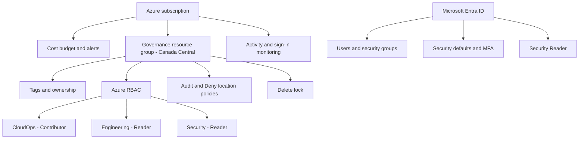

# Azure Identity & Governance Lab

**Microsoft Entra ID · Azure RBAC · Azure Policy · MFA · Cost Governance · Audit Logging**

> Hands-on Microsoft Azure administration and governance project for the fictional **Northstar Technologies** organization.

## Project overview

This portfolio lab demonstrates how to organize cloud resources, manage identity and access, apply least privilege, enforce regional deployment restrictions, protect resources from accidental deletion, and review audit evidence. The work is documented with real Azure portal captures.

## Key results

| Area | Lab configuration |
|---|---|
| Approved Azure region | **Canada Central** |
| Resource group | `rg-northstar-governance` |
| Organization tags | Environment: Lab; Project: Identity-Governance; Department: CloudOps; ManagedBy: CloudTeam |
| Identity | Four Microsoft Entra users; three security groups |
| Resource permissions | CloudOps: Contributor; Engineering: Reader; Security: Reader |
| Directory authorization | Security Reader role assignment |
| Sign-in protection | Security defaults enabled; Authenticator MFA registration |
| Regional governance | Separate Audit and Deny policy assignments |
| Intentional negative test | **East US deployment denied by policy** |
| Resource protection | Delete lock |
| Cost controls | Monthly budget of 10 in subscription currency; alerts at 50%, 80%, and 100% |
| Monitoring | Azure Activity Log, Entra audit logs and sign-in logs |

## Architecture and control flow

## Step-by-step implementation

| Step | Topic | What was demonstrated |
|---|---|---|
| 01 | [Resource organization and budget](deployment-steps/01-resource-organization.md) | Resource group, tags, budget and alerts |
| 02 | [Microsoft Entra users and groups](deployment-steps/02-entra-users-groups.md) | Users, three team security groups and memberships |
| 03 | [RBAC and directory roles](deployment-steps/03-rbac-roles.md) | Scoped Contributor/Reader and Security Reader assignments |
| 04 | [MFA and security defaults](deployment-steps/04-mfa-security.md) | Authentication hardening and registration |
| 05 | [Azure Policy and region validation](deployment-steps/05-azure-policy.md) | Audit, Deny and intentional East US rejection |
| 06 | [Resource locks and monitoring](deployment-steps/06-locks-monitoring.md) | Delete protection, Activity Log and identity audit evidence |

## Featured security validation: East US intentionally blocked

**Canada Central is the only approved region for this lab.** The `deny-northstar-region` policy was configured to reject resources outside that location. Attempting to create a network security group in **East US** produced the expected deployment-denied message.

**This is a successful test of the preventive security control—not a project failure.** The separate `audit-northstar-region` policy supports visibility and evaluation.

The compliance dashboard showed **100% with zero evaluated resources** at the moment captured. This must not be misrepresented as proof of compliance across a deployed resource fleet.

## Screenshot evidence

Twenty screenshots were captured, organized in the following order:

1. Budget configuration
2. Resource group overview
3. Entra users
4. Entra security groups
5. Resource-group RBAC assignments
6. Entra Security Reader assignment
7. Security defaults enabled
8. Authenticator MFA registration
9. Location Audit policy
10. Location Deny policy
11. East US deployment blocked
12. Resource-group Delete lock
13. Azure Activity Log
14. Azure Policy compliance
15. Entra sign-in logs
16. Entra audit logs
17. CloudOps group membership
18. Engineering group membership
19. Security group membership
20. Final governance review

**Image publication pending:** The screenshot files have not yet been transferred into GitHub. They will be linked and displayed here after successful upload and verification. This avoids broken images.

## Skills demonstrated

Azure administration · Microsoft Entra ID · Identity and access management · Azure RBAC · Least privilege · MFA · Azure Policy · Policy enforcement testing · Resource locks · Cost Management · Audit investigation · Governance documentation

## Notes

This is a lab scenario, not a production compliance certification. See [project notes](PROJECT-NOTES.md) for evidence limitations and publication status.
