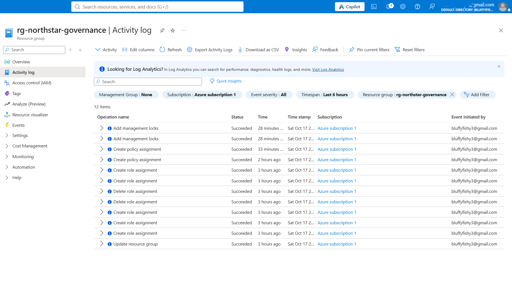
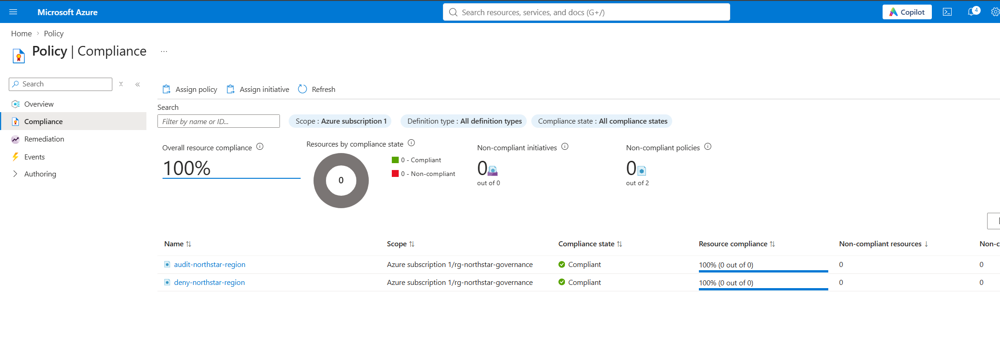
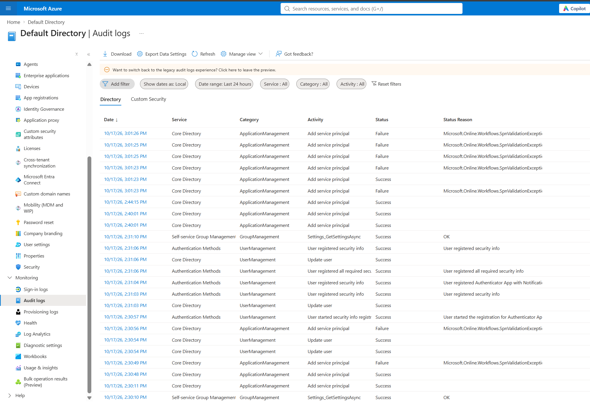
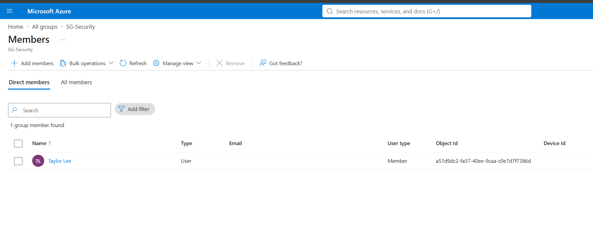

# Azure Identity & Governance Lab

This project is a hands-on Azure lab I built for a fictional company called **Northstar Technologies**.

The goal was to set up a simple identity and governance environment using **Microsoft Entra ID, Azure RBAC, MFA, Azure Policy, budgets, resource locks, and logs**.

**Main rule:** resources should be deployed in **Canada Central**. I tested this by intentionally trying to deploy a resource in **East US**, and Azure Policy blocked it.

## What I Set Up

- 4 Microsoft Entra ID users
- 3 security groups for CloudOps, Engineering, and Security
- Contributor and Reader permissions using Azure RBAC
- Microsoft Entra Security Reader role
- Security defaults and Microsoft Authenticator MFA
- Azure Policy to audit and block resources outside Canada Central
- Monthly Azure budget and cost alerts
- Delete lock on the governance resource group
- Azure Activity Log, Entra audit logs, and sign-in logs

---

## Lab Steps

### 1. Set Up a Budget

I created a monthly budget called `budget-northstar-lab` with a limit of **10**. I added alerts at **50%, 80%, and 100%** so I can track spending before it gets too high.

---

### 2. Create the Resource Group

I created `rg-northstar-governance` in **Canada Central**. I added tags for the environment, project, department, and management team to keep the lab organized.

---

### 3. Create Entra ID Users

I created four users in Microsoft Entra ID. I used these accounts to test group membership, permissions, MFA, and logging throughout the lab.

---

### 4. Create Security Groups

I created three security groups: `SG-CloudOps`, `SG-Engineering`, and `SG-Security`. I used groups so permissions could be managed by team instead of assigning access to each user one at a time.

---

### 5. Assign Azure Roles

I assigned **Contributor** to CloudOps and **Reader** to Engineering and Security on the resource group. This lets CloudOps manage resources while the other teams can view them without making changes.

---

### 6. Assign Security Reader

I assigned the **Security Reader** role in Microsoft Entra ID. This gives the security role read access to security-related information without giving full administrative access.

---

### 7. Enable Security Defaults

I enabled **Security defaults** in Microsoft Entra ID to add basic identity protection to the tenant.

---

### 8. Register MFA

I registered **Microsoft Authenticator** for MFA on a lab account. This adds another verification method instead of relying only on a password.

---

### 9. Create the Audit Policy

I created `audit-northstar-region` and set **Canada Central** as the allowed location. This policy can identify resources that do not follow the location rule.

---

### 10. Create the Deny Policy

I created `deny-northstar-region` with **Canada Central** as the allowed location. This policy blocks new resources from being deployed to a region that is not approved.

---

### 11. Test the Deny Policy

I intentionally tried to create a network security group in **East US**. The deployment was blocked because East US is outside the allowed Canada Central region. This was the expected result and confirmed that the Deny policy was working.

---

### 12. Add a Delete Lock

I added a **Delete** lock called `lock-northstar-delete` to the resource group. This helps protect the resource group from accidental deletion.

---

### 13. Check the Activity Log

I checked the Azure Activity Log to review changes made during the lab, including role assignments, policies, locks, and resource group updates.

---

### 14. Check Policy Compliance

I checked the Azure Policy compliance page after creating the policies. The page showed **100% compliance**, but there were **0 resources evaluated** at that time. The blocked East US test above is the main proof that the Deny policy worked.

---

### 15. Check Sign-In Logs

I checked Microsoft Entra sign-in logs to review login activity and sign-in results for the lab accounts.

---

### 16. Check Audit Logs

I checked Microsoft Entra audit logs to review identity and directory changes made during the lab.

---

### 17. Verify CloudOps Membership

I checked `SG-CloudOps` and confirmed its member. Because this group has the Contributor role, members of the group receive the CloudOps access assigned earlier.

---

### 18. Verify Engineering Access

I checked the Engineering setup and confirmed the user connected to the Engineering access. The Engineering group has the Reader role, so it can view resources without changing them.

---

### 19. Verify Security Membership

I checked `SG-Security` and confirmed its member. The group has Reader access to the Azure resource group.

---

### 20. Final Review

I reviewed the resource group one last time to confirm the **Canada Central** location and the tags used for the Northstar lab.

---

## What I Learned

This lab helped me practice how Azure identity and governance controls work together. I used groups and RBAC to control access, MFA and security defaults to improve account security, Azure Policy to enforce a location rule, a resource lock to protect the environment, and logs to review activity.

The most important test was the **East US deployment**. I chose the wrong region on purpose, and Azure blocked the deployment. That confirmed the location policy was enforcing the rule I configured.

## Technologies Used

- Microsoft Azure
- Microsoft Entra ID
- Azure RBAC
- Azure Policy
- Azure Cost Management
- Microsoft Authenticator
- Azure Activity Log
