# Azure Identity & Governance Lab

I built this project to practice how identity, access, security, and governance work together in Microsoft Azure. The lab is based on a fictional company called **Northstar Technologies** and uses **Canada Central** as its approved deployment region.

I created users and security groups in Microsoft Entra ID, assigned access with Azure RBAC, set up MFA and security defaults, enforced a regional rule with Azure Policy, added cost and deletion controls, and reviewed Azure and Entra logs.

> **Key result:** I intentionally tried to deploy a network security group in **East US**. Azure Policy blocked the deployment because only **Canada Central** was allowed. This confirmed that the policy was enforcing the rule I configured.

## What I Set Up

- 4 Microsoft Entra ID users and 3 security groups
- Contributor and Reader access with Azure RBAC
- Microsoft Entra Security Reader role
- Security defaults and Microsoft Authenticator MFA
- Azure Policy for the approved Canada Central region
- Monthly budget and cost alerts
- Delete lock on the governance resource group
- Azure Activity Log, Entra sign-in logs, and audit logs

---

## 1. Environment & Identity Setup

### Step 1 — Set Up a Budget

I created a monthly budget called `budget-northstar-lab` with a limit of **10 CAD** and alerts at **50%, 80%, and 100%**. I did this so I could track lab spending and catch unexpected costs early.

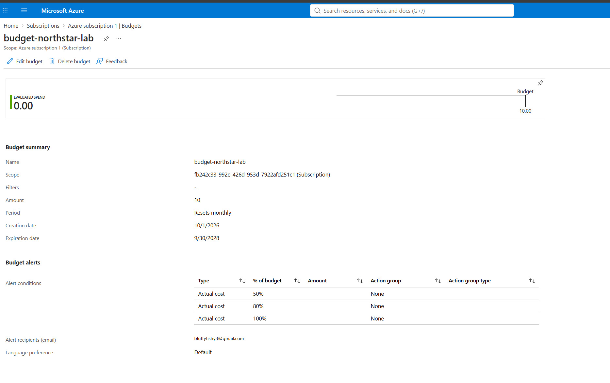

### Step 2 — Create the Resource Group

I created `rg-northstar-governance` in **Canada Central** and added tags for the environment, project, department, and management team. I used one organized resource group so the governance settings and lab resources were easier to manage.

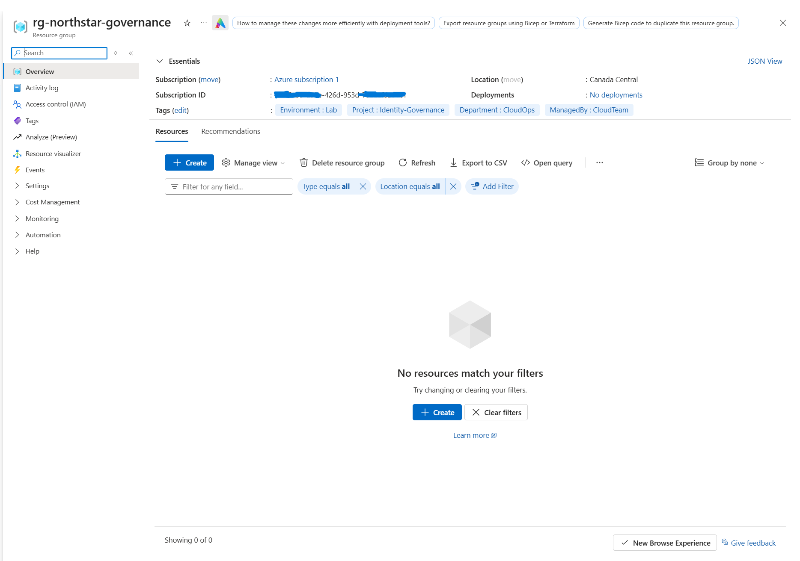

### Step 3 — Create Entra ID Users

I created four users in Microsoft Entra ID. I needed separate accounts so I could test different team memberships, permissions, MFA, and sign-in activity.

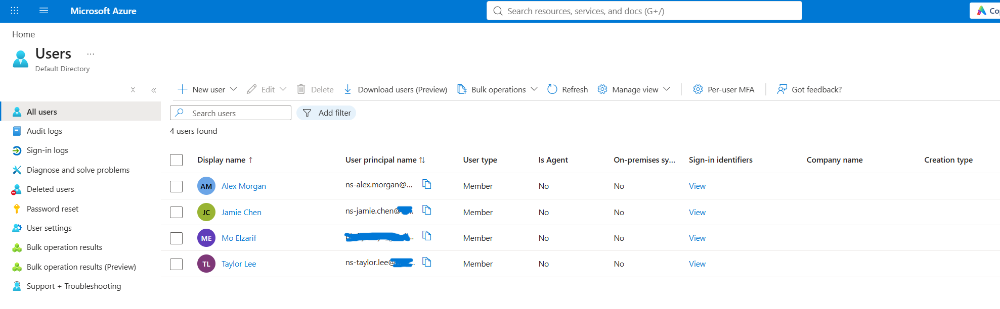

### Step 4 — Create Security Groups

I created `SG-CloudOps`, `SG-Engineering`, and `SG-Security`. I used groups because it is easier to manage access by team than to assign permissions to every user separately.

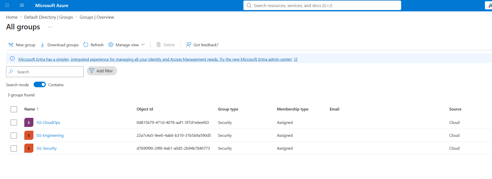

---

## 2. Access Control

### Step 5 — Assign Azure RBAC Roles

I assigned **Contributor** to CloudOps and **Reader** to Engineering and Security on the resource group. I did this to give CloudOps management access while keeping the other teams read-only.

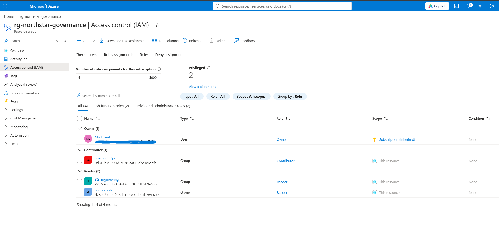

### Step 6 — Assign Security Reader

I assigned the **Security Reader** role in Microsoft Entra ID. I used this role so security information could be reviewed without giving full administrative access.

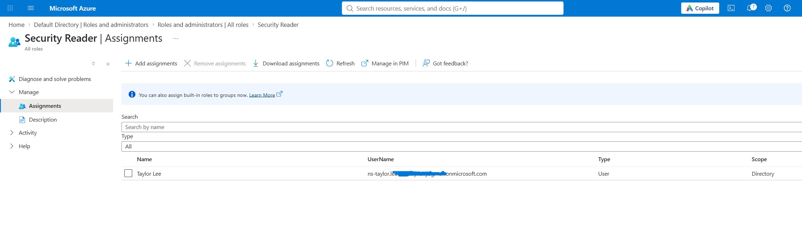

---

## 3. Identity Security

### Step 7 — Enable Security Defaults

I enabled **Security defaults** in Microsoft Entra ID. I did this to add basic identity protection to the tenant without creating a more advanced Conditional Access setup.

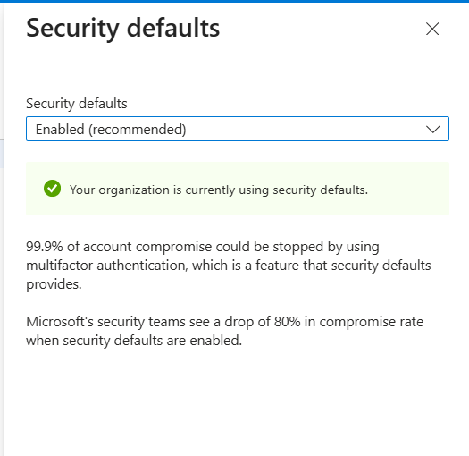

### Step 8 — Register MFA

I registered **Microsoft Authenticator** as an authentication method for a lab account. I did this so the account had another verification method instead of relying only on a password.

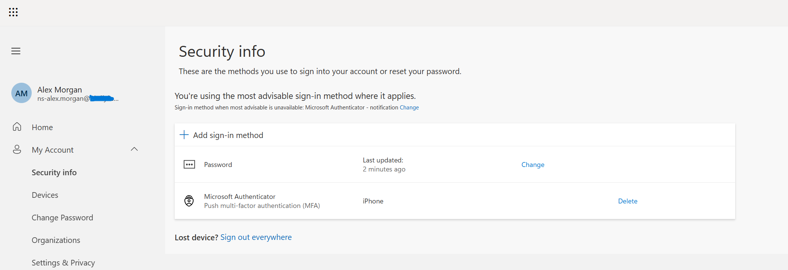

---

## 4. Governance & Resource Protection

### Step 9 — Create the Location Audit Policy

I created `audit-northstar-region` and set **Canada Central** as the allowed location. I used the Audit policy first so I could identify resources that did not follow the regional rule.

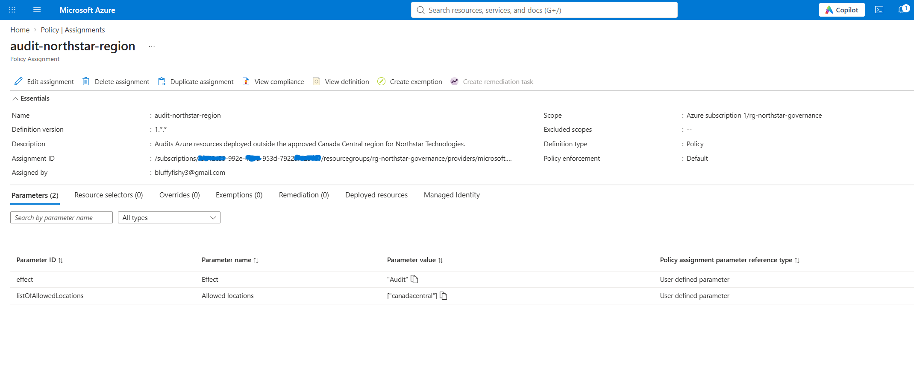

### Step 10 — Create the Location Deny Policy

I created `deny-northstar-region` with **Canada Central** as the allowed location. I used the Deny policy to stop new resources from being created outside the approved region.

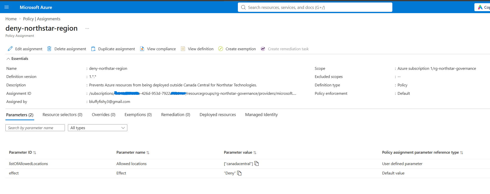

### Step 11 — Test the Policy by Deploying to East US

I intentionally tried to create a network security group in **East US**. Azure blocked the deployment because East US was outside the allowed Canada Central region.

**This was the expected result. It confirmed that the Deny policy was working and could prevent a non-approved deployment.**

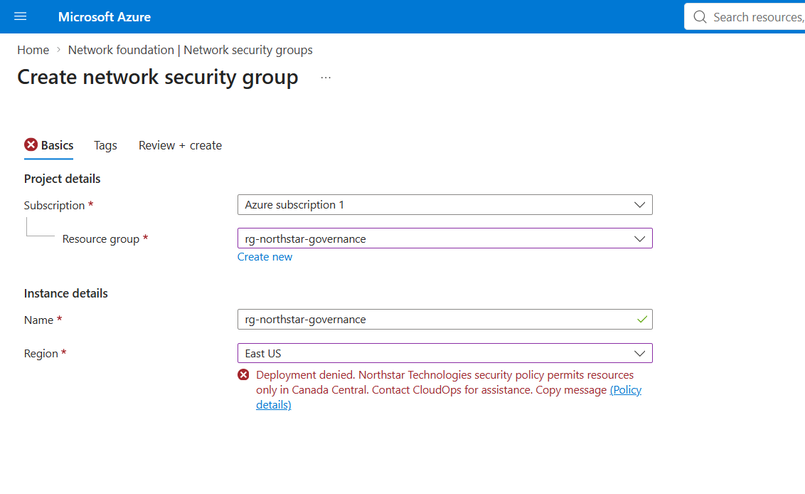

### Step 12 — Add a Delete Lock

I added a **Delete** lock called `lock-northstar-delete` to the resource group. I added the lock to reduce the risk of accidentally deleting the governance environment.

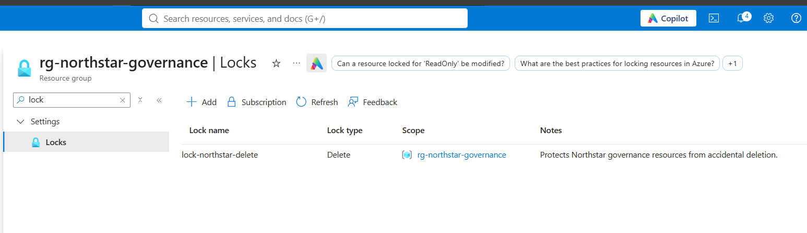

---

## 5. Monitoring & Verification

### Step 13 — Check the Activity Log

I checked the Azure Activity Log to review changes made during the lab. I used it to confirm that management actions such as policy, role, lock, and resource-group changes were being recorded.

### Step 14 — Check Policy Compliance

I checked the Azure Policy compliance page to review the policy state. The page showed **100% compliance**, but it also showed **0 resources evaluated**, so I did not treat this screen alone as proof of enforcement. The blocked East US deployment above is the direct test that confirmed the Deny policy worked.

### Step 15 — Check Sign-In Logs

I checked Microsoft Entra sign-in logs to review login activity and sign-in results. I used these logs to see the authentication activity generated by the lab accounts.

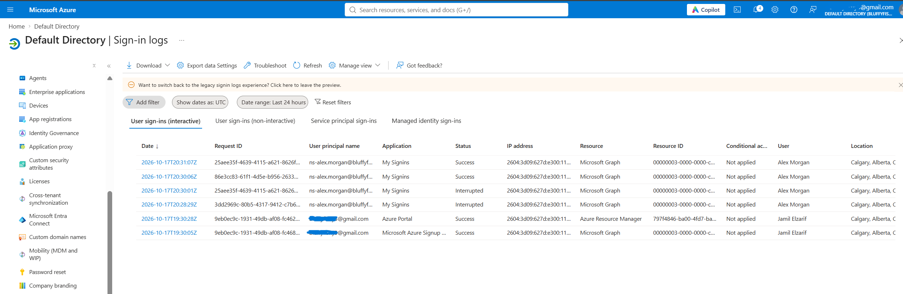

### Step 16 — Check Audit Logs

I checked Microsoft Entra audit logs to review identity and directory changes. I used the audit log because it provides a record of changes made inside Entra ID.

### Step 17 — Verify CloudOps Membership

I checked `SG-CloudOps` and confirmed its member. I verified this because group membership determines who receives the Contributor access assigned to CloudOps.

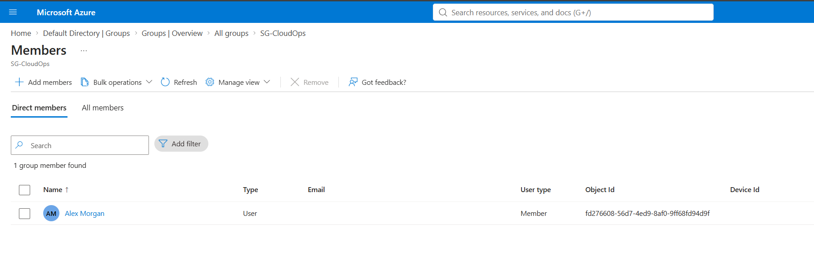

### Step 18 — Verify Engineering Access

I checked the Engineering setup and confirmed the user connected to the Engineering access. I verified this because the Engineering group should receive Reader access without permission to change resources.

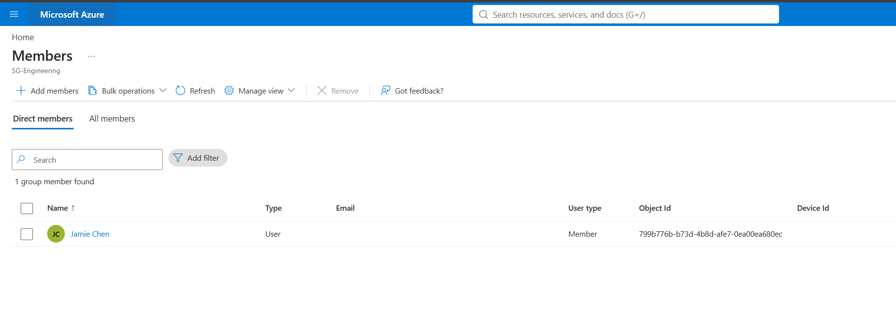

### Step 19 — Verify Security Membership

I checked `SG-Security` and confirmed its member. I verified the membership to make sure the intended security user was connected to the group's Reader access.

### Step 20 — Final Review

I reviewed the resource group one last time to confirm the **Canada Central** location and the tags used for the Northstar lab. This gave me a final check of the environment after completing the identity and governance setup.

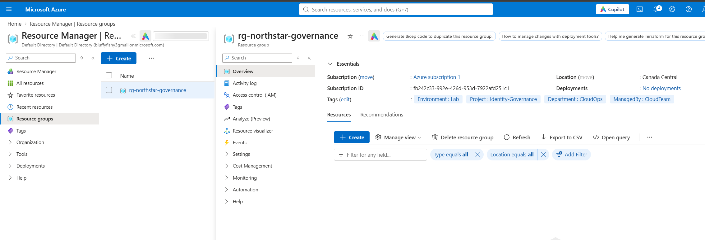

---

## What I Learned

This lab helped me understand how Azure identity and governance controls work together. I practiced using groups and RBAC for access, MFA for account security, Azure Policy for enforcement, resource locks for protection, budgets for cost awareness, and logs for monitoring.

The strongest part of the lab was testing the regional policy. I deliberately chose **East US**, and Azure blocked the deployment because it did not meet the **Canada Central** rule I configured.

## Technologies Used

Microsoft Azure · Microsoft Entra ID · Azure RBAC · Azure Policy · Azure Cost Management · Microsoft Authenticator · Azure Activity Log
